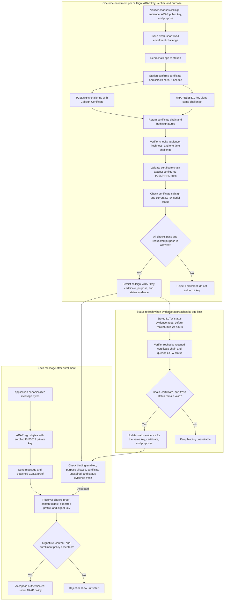

# ARRL-backed ARAP authentication flow

This diagram shows how a TQSL Callsign Certificate is used to enroll an ARAP
Ed25519 key, and how that enrolled key signs application messages. TQSL signs
the enrollment challenge; ARAP signs messages with Ed25519 afterward.

## What each signature proves

- The TQSL signature proves that the Callsign Certificate's private key signed
  this fresh, audience-bound enrollment challenge. TQSL handles that private
  key; ARAP does not export it.
- The enrollment challenge also binds the exact ARAP Ed25519 public-key
  fingerprint and requested purpose. The verifier independently checks the
  matching Ed25519 signature before storing the binding.
- Later messages are signed by the ARAP Ed25519 key. TQSL is not invoked for
  each message.
- Acceptance means the receiving application accepted this evidence under its
  ARAP policy. It is not an ARRL-approved login or endorsement, and it does not
  prove physical RF presence.

Enrollment is repeated when the ARAP key or Callsign Certificate is replaced,
or when a new verifier needs its own audience-bound binding. Status refresh is
separate: it obtains fresh LoTW status for the same enrolled binding. ARAP
provides the refresh operation but does not schedule it automatically.

See the [enrollment design](docs/LOTW-BINDING-DESIGN.md) for CLI commands and
validation details, and the [identity lifecycle guide](docs/IDENTITY-LIFECYCLE.md)
for key replacement and status policy.
